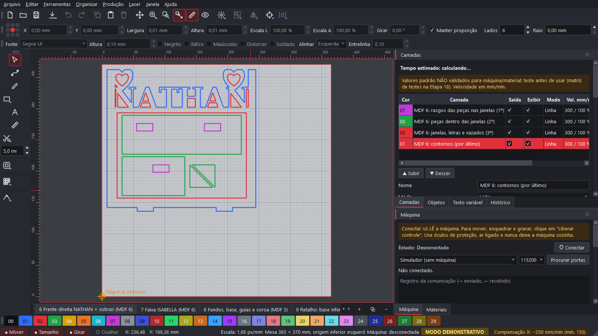
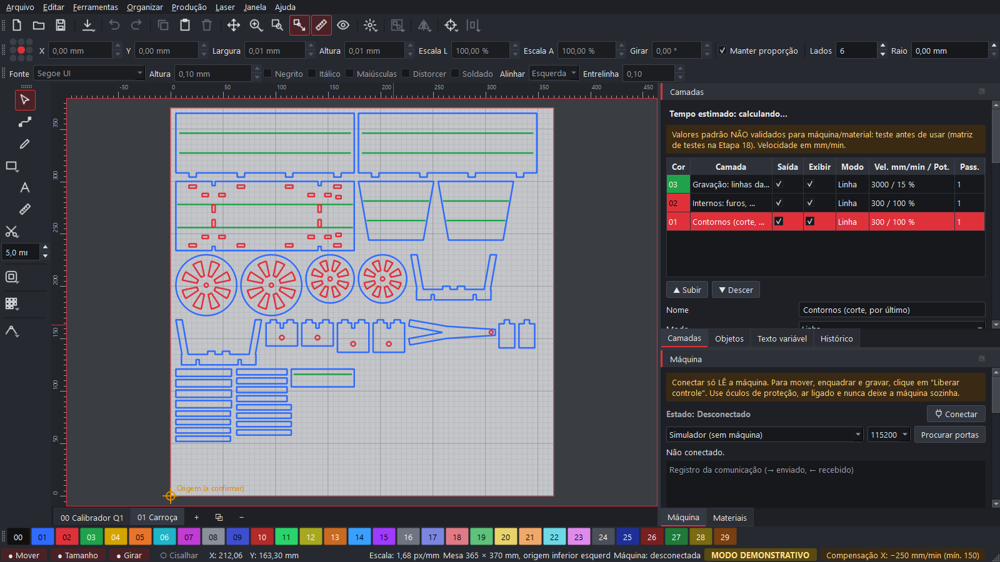

<div align="center">

# 🔴⚫ RedBlack Laser

**Software próprio para desenhar, preparar e cortar/gravar a laser, do vetor ao G-code e à máquina GRBL.**




</div>

---

## ✨ O que ele faz

| | |
|---|---|
| ✏️ **Desenho vetorial completo** | Formas com medida exata, nós, booleanas (solda, união, subtrair), offset, matrizes, aparar, texto e texto no caminho, códigos QR e EAN-13 |
| 📥 **Importa de tudo** | SVG, DXF, PDF/AI (vetores 1:1), PNG/JPG, com traçado de imagem (vetorizar) |
| 🎨 **30 camadas (C00–C29)** | Linha, preenchimento ou imagem, cada uma com velocidade, potência, passadas, kerf, pontes, sobrecorte e entrada/saída |
| 👁️ **Prévia do percurso** | Animação do caminho do laser, tempo estimado e ordem de corte (furos antes do contorno) |
| ⚙️ **G-code para GRBL** | Exportação validada (área, laser desligado no fim), compensação de velocidade no eixo X, kerf |
| 🕹️ **Controle da máquina** | Conectar, mover o cabeçote (botões e **setas do teclado**: toque = 10 mm, Alt 0,1, Ctrl 1, Shift 50; segurar = anda até soltar), enquadrar (com ou sem laser fraco), origem, homing, enviar, pausar e parar |
| 🧪 **Simulador GRBL** | Teste tudo sem máquina: o simulador responde como uma placa de verdade |
| 🏭 **Produção** | Texto variável com planilha CSV (lote), gabarito na mesa, frisos para dobrar MDF, matriz de testes de material, rotativo |
| 🔌 **Plugins** | Plano de corte (lista de materiais → chapas), orçamento em PDF, colorir metal, cilindros e copos |
| 🤖 **Servidor MCP** | O Claude/Codex criam e editam projetos `.rbl` conversando em português ([docs/MCP.md](docs/MCP.md)) |

## 📸 Projetos de exemplo

<table>
<tr>
<td width="50%"></td>
<td width="50%"></td>
</tr>
<tr>
<td><b>Carroça colonial</b>: 35 peças em MDF 3 mm redesenhadas em vetor a partir de um PDF que só tinha imagem, com encaixes conferidos por teste.</td>
<td><b>Porta-retrato Isabella e Nathan</b>: vetores 1:1 do PDF, com a base e os apoios cortados <i>dentro da sobra das janelas das fotos</i>.</td>
</tr>
</table>

Os geradores ficam em [`tools/projetos/`](tools/projetos) e cada um tem teste em `tests/test_projeto_*.py`.

## 🚀 Instalar

**Usuário final:** rode o `RedBlackLaser-<versão>-Setup.exe` (ou use o ZIP portátil). Para gerar os dois:

```powershell
powershell -ExecutionPolicy Bypass -File instalador\gerar.ps1   # PyInstaller + Inno Setup 6
```

**A partir do código:**

```powershell
python -m pip install -r requirements.txt   # PySide6 e pypdf
python -m redblack                           # abre o aplicativo
python -m redblack caminho\projeto.rbl       # abre direto um projeto
```

## 🧭 Primeiro corte em 5 passos

1. **Desenhe ou importe** (`Ctrl+I`): SVG, DXF, PDF ou imagem.
2. **Camadas**: ajuste velocidade, potência e passadas. Comece pela **Matriz de testes** (menu Laser).
3. **Prévia** (`Alt+P`): confira a ordem e o tempo.
4. **Máquina** → Conectar → *Liberar controle* → **Enquadrar** para ver onde o laser vai passar.
5. **Iniciar.** Use óculos de proteção, ligue o exaustor e nunca deixe a máquina sozinha.

> ⚠️ Os valores padrão das camadas são **ponto de partida**, não estão validados para a sua máquina e material.
> Faça a matriz de testes antes.

## ⌨️ Atalhos mais usados

| Ação | Atalho |
|---|---|
| Novo / Abrir / Salvar | `Ctrl+N` / `Ctrl+O` / `Ctrl+S` |
| Importar | `Ctrl+I` |
| Desfazer / Refazer | `Ctrl+Z` / `Ctrl+Y` |
| Exportar G-code | `Ctrl+Shift+G` |
| Prévia do percurso | `Alt+P` |
| Encaixe em pontos / Mostrar medidas | `F9` / `F10` |
| Ver a mesa inteira | `Ctrl+0` |
| Mover o laser (após clicar numa seta do painel Máquina) | `←↑→↓` (+ `Alt` / `Ctrl` / `Shift`) |

Lista completa: **[docs/GUIA.md](docs/GUIA.md)**.

## 🗂️ Estrutura

```text
redblack/            aplicativo (núcleo sem interface + ui/ em PySide6)
├── ui/              janela principal, área de desenho, painéis e diálogos
├── plugins/         plano de corte, orçamento, colorir metal, cilindros
├── gcode.py         geração de G-code GRBL      percurso.py   ordem e otimização do corte
├── conexao.py       serial/controle da máquina  simulador.py  GRBL simulado
├── importar_*.py    SVG, PDF, imagem            dxf.py        DXF
└── mcp_servidor.py  servidor MCP (Claude/Codex)
tools/projetos/      geradores de projetos prontos (.rbl)
instalador/          PyInstaller + Inno Setup
tests/               ~100 arquivos de teste (rodam sem tela)
docs/                guia, arquitetura, máquina, validação, MCP
```

## ✅ Testes

```powershell
python -m pytest tests -q                    # ou: python -m unittest discover -s tests
```

Os testes rodam sem tela (`QT_QPA_PLATFORM=offscreen`) e cobrem geometria, G-code, simulador, controle da máquina,
importadores, plugins e os projetos de exemplo.

## 📚 Documentação

| Documento | Conteúdo |
|---|---|
| [docs/GUIA.md](docs/GUIA.md) | Todas as funções, menus e atalhos |
| [docs/ARQUITETURA.md](docs/ARQUITETURA.md) | Módulos, formato `.rbl`, coordenadas, percurso |
| [docs/MAQUINA.md](docs/MAQUINA.md) | Perfil da máquina (mesa, GRBL, `$$`) |
| [docs/VALIDACAO.md](docs/VALIDACAO.md) | O que foi validado e como |
| [docs/MCP.md](docs/MCP.md) | Usar com o Claude/Codex |
| [PROGRESSO.md](PROGRESSO.md) · [ROADMAP.md](ROADMAP.md) | Histórico de entregas e próximos passos |

## 🔒 Segurança

- O controle da máquina só funciona depois de **Liberar controle**, que pede confirmação. Antes disso o app só lê o estado.
- Mover o cabeçote (*jog*) nunca liga o laser. Soltar a tecla ou o app perder o foco **cancela o movimento na hora**.
- O enquadramento com laser fraco tem potência limitada. Pausar e Parar funcionam o tempo todo.

---

<div align="center">

© 2026 **RedBlack**. Todos os direitos reservados ([termos](instalador/LICENCA.txt)).
Desenvolvido pela RedBlack com o assistente de IA Claude (Anthropic).

</div>
